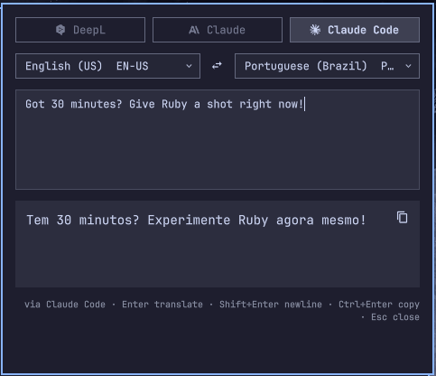

# Omarchy Translator

A translator in your [Omarchy](https://omarchy.org) 4 bar, backed by the provider of
your choice: [DeepL](https://www.deepl.com), [Claude](https://claude.com) (through the API
or your [Claude Code](https://claude.com/claude-code) login) or Google
[Gemini](https://ai.google.dev) (a free API key works).
Click the 󰗊 icon, type, press Enter.

<p align="center">
  
</p>

New to QML or curious how the pieces fit? Read **[docs/HOW_IT_WORKS.md](docs/HOW_IT_WORKS.md)**.

The UI is QML (it runs inside Omarchy's Quickshell bar and follows your theme).
The translation is done by a small Ruby CLI that uses only the standard library.

## Features

| Action | What happens |
|---|---|
| **Left click** | Opens the popup: source → target language (English → Portuguese (Brazil) until you pick others), multi-line text box, result |
| **Right click** | Translates the clipboard → notification; result is copied |
| **Middle click** | Select a screen region → OCR (tesseract) → translate → notification |

In the popup: <kbd>Enter</kbd> translates, <kbd>Shift</kbd>+<kbd>Enter</kbd> adds a new
line, <kbd>Ctrl</kbd>+<kbd>Enter</kbd> or the 󰆏 button copies the result (or select part
of it with the mouse), <kbd>Esc</kbd> closes, and 󰓡 swaps the languages. The buttons above the languages (each with the
provider's logo) switch provider; the ones you haven't set up are dimmed and show what to add when picked.
The last provider and languages you used are remembered.

Text is cleaned up before it goes to the provider, whichever way it came in (popup, clipboard
or OCR). Line wraps inside a paragraph are joined, words hyphenated across a line break
are rejoined (compounds such as "e-mail", or ones written with a hyphen elsewhere in the text,
keep it), and invisible characters (zero-width spaces, soft hyphens, NBSPs, control
characters) are dropped. Blank-line paragraph breaks, punctuation and accents are kept.

## Requirements

- Omarchy 4 (Quickshell bar)
- Ruby 4.0 (managed with [mise](https://mise.jdx.dev), see `mise.toml`)
- At least one provider (see [Providers](#providers)). The easiest start is a DeepL key:
  the [free plan](https://www.deepl.com/pro-api) gives 500k characters/month. A free
  [Gemini key](https://aistudio.google.com/apikey) needs no billing either. If you
  already use [Claude Code](https://claude.com/claude-code), it works with no key at all.
- For middle-click OCR: `slurp`, `grim`, `tesseract` (all shipped with Omarchy)

## Install

```sh
git clone <this repo> ~/Projects/my_omarchy_translator
cd ~/Projects/my_omarchy_translator
mise install                      # Ruby from mise.toml

# 1. API key(s), kept outside the repo (see Providers below for the others;
#    skip this if you only use Claude Code)
mkdir -p ~/.config/omarchy
echo 'DEEPL_AUTH_KEY=your-key:fx' >> ~/.config/omarchy/translator.env
chmod 600 ~/.config/omarchy/translator.env

# 2. Register and place the widget
ln -sfn "$PWD" ~/.config/omarchy/plugins/local.translator
omarchy plugin enable local.translator --section right
```

Want to work on the code? See [Development](#development) for the setup and the
edit–reload loop.

Once it's pushed to a git host, the plugin can also be installed with
`omarchy plugin add <git-url>`.

### Optional hotkey

Add to `~/.config/hypr/bindings.conf`:

```
bindd = SUPER ALT, T, Translator, exec, omarchy-shell shell toggle local.translator
```

## CLI

The CLI also works without the bar:

```sh
bin/omarchy-translate --to PT-BR "Hello world"
echo "Bonjour tout le monde" | bin/omarchy-translate
bin/omarchy-translate --clipboard --notify
bin/omarchy-translate --json --to DE -- "Good morning"
bin/omarchy-translate --provider claude --to JA "See you tomorrow"
bin/omarchy-translate --status        # active provider and which ones are configured
bin/omarchy-translate --languages
bin/omarchy-translate --help
```

## Providers

Put the settings for any providers you want in `~/.config/omarchy/translator.env`
(an environment variable with the same name overrides the file). The popup lists
every provider and dims the ones that aren't configured yet.

| Provider (`--provider`) | Settings | Notes |
|---|---|---|
| DeepL (`deepl`) | `DEEPL_AUTH_KEY` (`DEEPL_API_URL` optional) | Strong quality for European languages. Keys ending in `:fx` use the free endpoint (500k chars/month) |
| Claude (`claude`) | `ANTHROPIC_API_KEY` (`ANTHROPIC_MODEL`, `ANTHROPIC_API_URL` optional) | Defaults to `claude-opus-5-5` at low effort; set `ANTHROPIC_MODEL=claude-haiku-5-5` for faster, cheaper translations |
| Gemini (`gemini`) | `GEMINI_API_KEY` (`GEMINI_MODEL`, `GEMINI_API_URL` optional) | Free: create a key at [Google AI Studio](https://aistudio.google.com/apikey), no billing needed. Defaults to `gemini-3.5-flash-lite`. The free tier has daily request limits per model (see your quota in AI Studio), and Google may use free-tier prompts to improve its products, so don't send anything private. Set `GEMINI_MODEL=gemini-3.8-flash` for higher quality but a lower free quota |
| Claude Code (`claude-code`) | None: needs the `claude` CLI on `PATH` and a login (`CLAUDE_CODE_BIN`, `CLAUDE_CODE_MODEL` optional) | Uses your Claude Code subscription instead of an API key, so translations count toward its usage limits. Each request starts the CLI (a few seconds). Uses Claude Code's default model at low effort; set `CLAUDE_CODE_MODEL=haiku` for speed |

Example:

```sh
DEEPL_AUTH_KEY=your-key:fx
ANTHROPIC_API_KEY=sk-ant-…
GEMINI_API_KEY=AIza…
CLAUDE_CODE_MODEL=haiku       # optional: faster Claude Code translations
TRANSLATOR_PROVIDER=deepl     # optional: default (else claude-code) before you pick one
```

Claude translates more freely than DeepL (it handles idioms and tone well, but
may rephrase), and each request takes a few seconds. Claude Code is ready to use
as soon as `claude` is installed; it runs `claude -p` with no tools and
no saved session, from a temporary directory so no project `CLAUDE.md` is read.

## Configuration

| What | Where |
|---|---|
| Provider keys and endpoints | `~/.config/omarchy/translator.env`, or env vars of the same name (see [Providers](#providers)) |
| Default provider | Claude Code; override with `TRANSLATOR_PROVIDER=…` in the same file (the last one used wins once you pick one) |
| Last used provider and languages | `~/.local/state/omarchy/translator.json` |
| OCR languages | `OMARCHY_OCR_LANGS`, e.g. `eng+por` |

## Development

### 1. Set up the project

You need Omarchy 4 and [mise](https://mise.jdx.dev) (both ship with Omarchy), plus
`qt6-declarative` for the QML gates (`qmllint`, `qmltestrunner`; already installed
with the Omarchy shell).

```sh
git clone <this repo> ~/Projects/my_omarchy_translator
cd ~/Projects/my_omarchy_translator
mise install        # Ruby 4.0.2 from mise.toml
mise run setup      # dev gems: RuboCop, Minitest, SimpleCov, bundler-audit (runtime code needs none)
bin/ci              # every quality gate; it should be green before you change anything
```

### 2. Start it on your Omarchy

The repository root *is* the plugin, so you link it into Omarchy's plugin folder and
enable it once:

```sh
ln -sfn "$PWD" ~/.config/omarchy/plugins/local.translator
omarchy plugin enable local.translator --section right
mise run reload     # restart the shell so it picks the plugin up
```

The 󰗊 icon now appears on the right of the bar. With the `claude` CLI installed and
logged in, it translates right away; otherwise add a provider key to
`~/.config/omarchy/translator.env` (see [Providers](#providers)). To open the popup
from a terminal:

```sh
omarchy-shell shell toggle local.translator
```

To remove it again: `omarchy plugin disable local.translator` and delete the link.

### 3. Day to day

```sh
mise run reload     # after every QML edit (there is no hot reload for a linked plugin)
bin/ci              # before committing (same as mise run check)
mise tasks          # list all tasks
```

Ruby changes need no reload: the CLI starts fresh for each request, so you can also
try them directly with `bin/omarchy-translate` (see [CLI](#cli)). To see the widget's
logs and QML errors:

```sh
quickshell log -i "$(ls -t /run/user/$UID/quickshell/by-id | head -1)" | grep -i translator
```

Ignore the `IpcHandler … another handler is registered` warnings; they come from
built-in widgets.

#### Trying the popup without a real key

The test suite's fake DeepL server answers every request with "Olá mundo". Start it
in one terminal:

```sh
ruby -Itest/support -rfake_api -e 'puts FakeDeepL.new.url; $stdout.flush; sleep'
```

and point the widget at the URL it prints:

```sh
printf 'DEEPL_AUTH_KEY=anything\nDEEPL_API_URL=http://127.0.0.1:<port>\n' >> ~/.config/omarchy/translator.env
```

Then pick DeepL in the popup's provider buttons. Remove those two lines when you're done.

### Quality gates

`bin/ci` (also `mise run check`) runs these gates in order, like Rails' `bin/ci`, and
ends with a pass/fail summary and timings. It exits non-zero if any gate failed.
`bin/ci --fail-fast` stops at the first failure, and `bin/ci tests` runs only the
gates whose name contains "tests".

| Gate | Tool | Config |
|---|---|---|
| Ruby lint and format | RuboCop + `rubocop-minitest` + `rubocop-rake` | `.rubocop.yml` |
| Formatting | `.editorconfig` rules (LF, final newline, no trailing whitespace or tabs) on QML, JS, shell, Markdown, JSON, TOML | `script/check-format` |
| QML lint | Qt 6 `qmllint` against the live shell's `qs.*` modules | `script/lint-qml` |
| Gem audit | `bundler-audit` against the latest advisory database (dev gems only; the runtime has none) | `Gemfile.lock` |
| Tests + coverage | Minitest: every provider client over a real local socket, config, and the CLI binary end to end. SimpleCov measures line and branch coverage, including the CLI child processes, and fails below the floor | `test/`, `test/support/coverage.rb` |
| QML tests | Qt 6 `qmltestrunner` (headless): unit tests for `PanelLogic.qml`, and component tests that drive the real `Panel.qml` and `BarWidget.qml` with keys and clicks, with Quickshell stubbed out | `test/qml/`, `test/qml/stubs/`, `script/test-qml` |
| Plugin manifest | `omarchy plugin validate` | `manifest.json` |

The coverage report is written to `coverage/index.html` (git-ignored). The gem audit needs
the network to update its advisory database.

Tooling: the Ruby version and tasks are in `mise.toml` (the version is mirrored in
`.tool-versions` for asdf), and editor settings are in `.editorconfig`.

Why there's no hot reload, and the rest of the project's conventions, are in
[AGENTS.md](AGENTS.md). AI agents should read it first.

## Project layout

```
manifest.json              Omarchy plugin manifest
BarWidget.qml / Panel.qml  Bar icon and popup (QML)
ProviderLogo.qml           Provider logos for the popup's provider buttons
PanelLogic.qml             The popup's pure logic (labels, options, swap), tested headless
bin/omarchy-translate      CLI
bin/ci                     Runs every quality gate
lib/omarchy_translator.rb  Language tables, text cleanup, provider registry
lib/omarchy_translator/    Config and one client per provider (providers/)
script/lint-qml            QML lint gate
script/test-qml            QML test gate (qmltestrunner)
script/qs-imports          Lays out Omarchy's qs.* modules for qmllint and qmltestrunner
script/check-format        Formatting gate for non-Ruby files
test/                      Minitest suite (+ support/), QML tests in test/qml/ (Quickshell stubs in stubs/)
docs/HOW_IT_WORKS.md       QML primer and architecture
```

----------
Released in 2026

By [Victor B. Fiamoncini](https://github.com/Victor-Fiamoncini) ☕️
