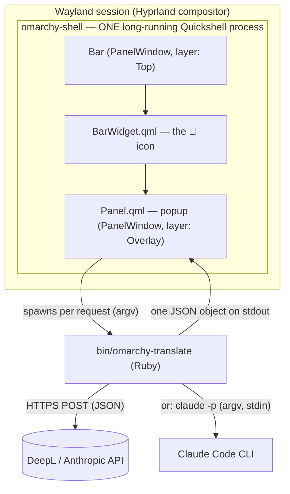
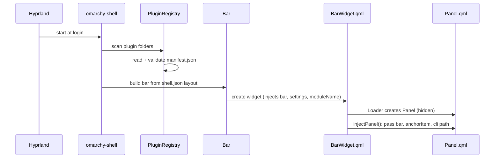
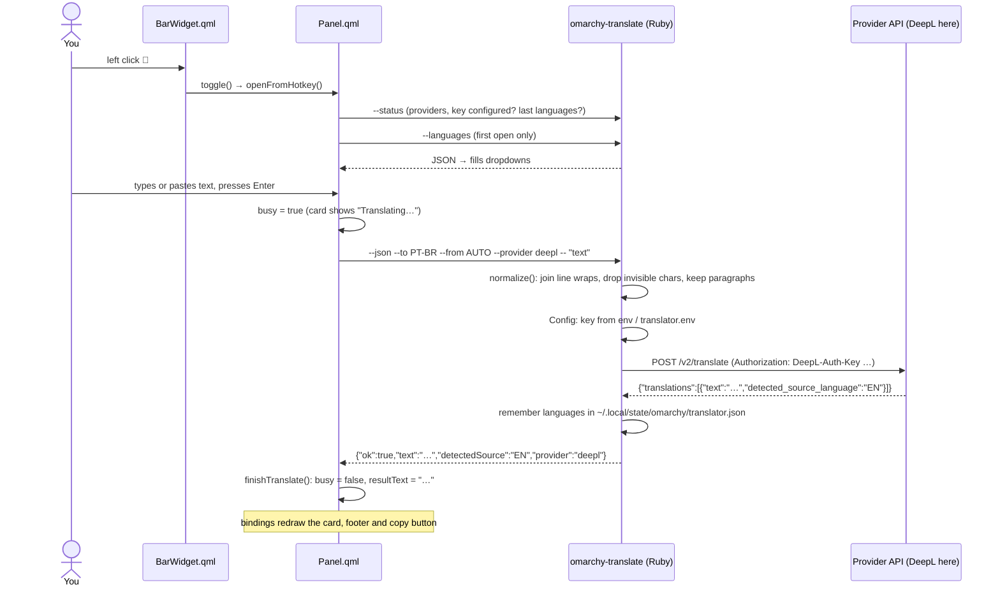

# How it works: QML, Quickshell and the Translator

Want a slower, standalone QML tutorial first? See [QML_BASICS.md](QML_BASICS.md).

This guide explains how this project works for someone who knows Ruby (or web
development) but hasn't used Qt or QML. It has three parts:

1. [The stack](#1-the-stack): what Qt, QML, Quickshell and the Omarchy shell are
2. [QML in 10 minutes](#2-qml-in-10-minutes): the language, using this repo's code as examples
3. [How the Translator works](#3-how-the-translator-works): what happens from click to translation

---

## 1. The stack



Each layer, from the bottom up:

| Layer | What it is | Ruby/web analogy |
|---|---|---|
| **Qt** | A large C++ framework for GUI apps (KDE, many desktop apps) | The standard library + runtime |
| **Qt Quick** | Qt's GPU-rendered UI toolkit: rectangles, text, animations, input | The browser's rendering engine |
| **QML** | The declarative language you write Qt Quick UIs in. It looks like JSON with JavaScript inside | HTML + CSS + JS in one file |
| **Quickshell** | A toolkit for building desktop shells (bars, panels, lock screens) in QML. It adds Wayland windows, running processes, file watching and IPC | A framework like Rails, specialised for desktop UI |
| **omarchy-shell** | Omarchy 4's desktop UI: one Quickshell program that hosts the bar, menus, notifications, lock screen, and **plugins** | Your Rails app, with this project as an engine mounted into it |

### What "one long-running process" means

Hyprland starts `quickshell -p /usr/share/omarchy/shell` once when you log in.
The bar and every popup live **inside that process**. So:

- Opening a popup is instant: the code is already loaded, and the shell only shows a window.
- A plugin is code loaded into the shell. A QML crash or infinite loop in a
  plugin affects the whole desktop UI. That's the main reason this project
  keeps network calls and parsing **out** of QML and in a separate Ruby process.

### Windows on Wayland: layer shell

Normal apps open normal windows. Bars and popups use Wayland's
**layer-shell** protocol instead, which lets them sit above or below regular
windows and reserve screen space. In Quickshell a layer-shell window is a
`PanelWindow`:

- The bar is a `PanelWindow` on the **Top** layer.
- The popup (Omarchy's `KeyboardPanel`) is another `PanelWindow` on the
  **Overlay** layer. It takes keyboard focus only while open, which is why you can type into it.

You never create these windows yourself. The Omarchy components do it.

### Plugins

Omarchy discovers plugins in two places:

- `/usr/share/omarchy/shell/plugins/`: first-party plugins (clock, weather, audio…)
- `~/.config/omarchy/plugins/<id>/`: yours. This repo is symlinked there as `local.translator`.

Each plugin has a `manifest.json` that tells the shell what it is:

```json
{
  "id": "local.translator",
  "kinds": ["bar-widget"],
  "entryPoints": { "barWidget": "BarWidget.qml" },
  "barWidget": { "defaultSection": "right" }
}
```

`omarchy plugin enable local.translator --section right` writes the widget
into the bar layout in `~/.config/omarchy/shell.json`. The bar then creates
one `BarWidget.qml` instance per monitor.

---

## 2. QML in 10 minutes

### A QML file is a class

`BarWidget.qml` defines a type. The first object in the file (the *root*) is
what you're extending:

```qml
import QtQuick          // Qt's base UI types: Item, Rectangle, Text, Timer…
import Quickshell       // Quickshell.execDetached, windows…
import qs.Commons       // Omarchy's design tokens: Style, Color
import qs.Ui            // Omarchy's components: BarWidget, Panel, TextField…

BarWidget {              // "class BarWidget < Omarchy::BarWidget"
  id: root               // a name other objects in this file can refer to
  moduleName: "local.translator"
  ...
}
```

The `qs.*` imports are the Omarchy shell's own modules (`qs` = *Quickshell
root*). They're the design system, so using `Style.space(12)`,
`Style.font.title` and `Color.urgent` instead of raw numbers and hex codes is
what makes the widget follow your theme.

### Objects nest into a tree

Children are declared inside parents, much like HTML elements:

```qml
Column {                       // stacks children vertically
  spacing: Style.space(12)

  TextArea { id: inputField; placeholderText: "Type or paste text · Enter to translate" }

  Rectangle {                  // the result card
    radius: Style.cornerRadius
    TextEdit { id: resultEdit; readOnly: true }
  }
}
```

Layout is done with containers (`Row`, `Column`) and **anchors**
(`anchors.fill: parent`, `anchors.right: parent.right`). Anchors are like
CSS absolute positioning, but relative to named edges of other items.

### Properties and bindings: the key idea

A property is a typed field:

```qml
property bool busy: false
property string resultText: ""
```

When you assign an **expression** to a property, QML creates a **binding**. The
expression re-runs automatically whenever anything it reads changes, like a
spreadsheet formula or a React render:

```qml
TextEdit {
  text: root.busy ? "Translating…"
      : root.errorText !== "" ? root.errorText
      : root.resultText
  color: root.errorText !== "" ? Color.urgent : root.barForeground
}
```

Nothing ever tells the `TextEdit` to update. When `root.busy` flips to
`false` and `root.resultText` gets a value, the text and colour recompute
themselves. So most of `Panel.qml` is **state** (properties) plus **UI that
derives from the state** (bindings). The imperative code only changes state.

> ⚠️ An imperative assignment (`text = "x"` inside a function) **breaks** the
> binding on that property. After that it's a plain value. So prefer changing
> the state the binding reads from.

### Signals and handlers: events

Objects emit **signals** and you react with `on<Signal>` handlers:

```qml
Dropdown {
  onChanged: function(v) { root.targetLang = v; root.translate() }
}
```

Every property also gets a free `on<Property>Changed` signal
(`onBarChanged: injectPanel()` in `BarWidget.qml`). This is the observer
pattern, built into the language.

### Functions are JavaScript

```qml
function translate() {
  var text = inputField.text.trim()
  if (text === "" || root.cli === "") return
  ...
}
```

It's ordinary JavaScript. `JSON.parse`, arrays, string methods and closures
all work as usual.

### Loader: create-on-demand

```qml
Loader { id: panelLoader; source: Qt.resolvedUrl("Panel.qml") }
```

A `Loader` creates another QML file's object at runtime. `panelLoader.item` is
the live object. `Qt.resolvedUrl()` turns a relative path into an absolute URL
based on the current file's location. We use the same trick to find the Ruby
CLI next to the QML files.

### Quickshell's non-UI objects

| Type | Module | What we use it for |
|---|---|---|
| `Process` + `StdioCollector` | `Quickshell.Io` | Run the Ruby CLI and collect its stdout |
| `Quickshell.execDetached([...])` | `Quickshell` | Fire-and-forget commands (`wl-copy`, right-click translate) |
| `Timer` | `QtQuick` | Request timeout (watchdog), the "Copied" flash |

```qml
Process {
  id: translateProc
  stdout: StdioCollector {
    waitForEnd: true
    onStreamFinished: root.finishTranslate(Logic.parseJson(text))
  }
}
// later:
translateProc.command = [root.cli, "--json", "--to", root.targetLang, "--", text]
translateProc.running = true
```

The command is an **argv array**, not a shell string. The user's text goes
straight to Ruby's `ARGV` and no shell ever interprets it, so input like
`$(rm -rf ~)` is just text to translate.

---

## 3. How the Translator works

### The files

| File | Role |
|---|---|
| `manifest.json` | Tells Omarchy "I'm a bar widget, my entry point is `BarWidget.qml`" |
| `BarWidget.qml` | The icon in the bar. Handles clicks and owns the popup via a `Loader` |
| `Panel.qml` | The popup: state, UI, and the `Process` calls to Ruby |
| `ProviderDropdown.qml` | The provider picker. `qs.Ui`'s `Dropdown` only renders text, so this copies its trigger, popup and keys (same theme tokens) and adds each provider's logo and a dimmed "not set up" row for providers without settings |
| `ProviderLogo.qml` | A provider's logo (an SVG path drawn with `QtQuick.Shapes`, tinted with the theme colour) for the provider picker |
| `PanelLogic.qml` | The popup's pure functions (dropdown and provider options, labels, footer hints, swap). A plain `QtObject` that `Panel.qml` declares as `PanelLogic { id: logic }`, so `test/qml/` can test it without the shell |
| `bin/omarchy-translate` | The CLI: parses options, reads text, prints the result or JSON |
| `lib/omarchy_translator.rb` | Language tables, `normalize`, the `PROVIDERS` registry |
| `lib/omarchy_translator/providers/` | One client per provider (HTTP, or the local `claude` CLI for Claude Code), all subclasses of `Provider` (`base.rb`) |
| `lib/omarchy_translator/config.rb` | `Config`: settings from the env file, the active provider, remembered choices |

### Startup: how the widget gets into the bar



The host **injects** `bar` into the widget: an object with theme colours,
fonts, and helpers like `switchPanelFrom`. The widget forwards `bar` to the
panel in `injectPanel()`. It's dependency injection, done by the host.

### A translation, click to result



On failure the CLI still prints one JSON object (`{"ok":false,"error":"DeepL
rejected the API key"}`), and the card shows it in red. That rule covers every
failure: a missing key, a bad language, provider errors, the network being down,
or a crash in Ruby. It's why the popup never ends up empty or stuck. A missing
key also sets `"needsSetup":true`, and the card then shows how to configure
that provider.

Two safety nets in `Panel.qml`:

- **Watchdog**: if Ruby hasn't answered within 65 s (LLM providers get 30 s
  each to connect and to answer), the popup shows "Translation timed out".
- **Pending retranslate**: changing a language while a request is running
  queues a new request instead of dropping the change.

### The other clicks

Both skip the popup and run the CLI directly with `--notify`, which sends a
desktop notification and copies the result:

| Click | Command |
|---|---|
| Right | `omarchy-translate --clipboard --notify` (text from `wl-paste`) |
| Middle | `slurp` (select a region) → `grim` (screenshot) → `tesseract` (OCR) → piped into `omarchy-translate --notify` |

### Providers

Each provider is a small class in `lib/omarchy_translator/providers/` that
inherits from `Provider`. The base class does the JSON POST and turns network
failures and HTTP errors into friendly messages. Each subclass adds:

- `configured?(config)` and `setup_hint(config)`: which env settings it needs.
- `from_config(config)`: builds the client from those settings.
- `translate(text, target:, source:)`: returns `{ text:, detected_source: }`.

Every provider shares the same canonical language codes (DeepL's: `PT-BR`,
`ZH-HANS`, …), so the dropdowns, swap button and remembered state work the
same way for each. A provider whose API uses other codes maps them on the way
out (`wire_code`), and the language it detects is mapped back to a canonical
code (`canonical_source`).

The Claude and Gemini providers use `LLMTranslation`. It sends the language *names* in a
system prompt, wraps the text in `<text>` tags so the model treats it as data,
and asks for `{"detected_source","text"}` JSON, enforced through structured
outputs (Claude's `output_config.format`, Gemini's `responseJsonSchema`). A reply
in plain text still works: the text is used as the translation. Gemini calls
`v1beta/models/<model>:generateContent` with the key in `x-goog-api-key`. A bad key
comes back as a 400 (`API_KEY_INVALID`), not a 401, so the client maps that one itself.

The Claude Code provider reuses the same prompt but doesn't make an HTTP call.
It runs the local `claude` CLI headless (`claude -p --output-format json
--json-schema … --tools ''`) through `Open3`, with the text on stdin and an argv
array (never a shell string). It reads the CLI's `structured_output` (or its
`result` text), kills the process after 60s, and turns `is_error` replies such as
"Not logged in" into the error the popup shows. It counts as configured when
`claude` is found on `PATH` (or at `CLAUDE_CODE_BIN`), so it needs no key. The
tests swap in a script from `test/support/fake_claude.rb` through that setting.

`Config#provider` picks the active provider in this order: the remembered
one (if it's still configured), then `TRANSLATOR_PROVIDER` (default
`claude-code`), then the first configured provider. The popup's **Translate with**
dropdown lists every provider with its logo, the configured ones first. It dims the
others and shows that provider's `setupHint` (from `--status`) when one of them is picked.

### Testing the QML

`script/test-qml` runs `qmltestrunner` headless (`QT_QPA_PLATFORM=offscreen`) on
`test/qml/tst_*.qml`:

- `tst_panel_logic.qml` unit-tests the pure functions in `PanelLogic.qml`.
- `tst_panel.qml` and `tst_bar_widget.qml` are component tests. They create the
  real `Panel.qml` / `BarWidget.qml`, type with `keyClick`, click with
  `mouseClick`, and check the argv sent to the CLI and what the popup shows.

The real `qs.Commons` and `qs.Ui` load as they are. Quickshell itself can't:
its QML plugin is compiled into the `quickshell` binary, and its windows need a
Wayland compositor. So `test/qml/stubs` stands in for the parts the widget
touches. `Quickshell.execDetached` is recorded, and `Process` asks
`FakeProcesses.respond(argv)` for its stdout (return `null` to simulate a CLI
that hangs). `KeyboardPanel`, a layer-shell window, becomes a plain `Item`.
`script/qs-imports` builds the `qs/` import layout in a temporary directory,
swapping in the stubbed `KeyboardPanel`.

The CLI behind `Process` is covered by the Ruby tests. Pixels and theming
still need a look after `mise run reload`.

### Why the Ruby side is a separate process

- **Isolation**: a hung HTTP call or a Ruby exception can't freeze the desktop shell.
- **Testability**: plain Ruby tested with Minitest, including a real local
  HTTP server (`test/support/fake_api.rb`), a stand-in `claude` script
  (`test/support/fake_claude.rb`) and the actual executable.
- **Reuse**: the same CLI works from a terminal, a script, or a Hyprland keybind.
- **No dependencies**: stdlib only (`net/http`, `json`, `optparse`, `open3`), so the
  shell can run it directly without Bundler.

Starting Ruby takes about 110 ms per request (measured through the mise shim), which you won't notice next
to a network round trip.

### Where things are stored

| Data | Location | Written by |
|---|---|---|
| API keys, optional endpoints, default provider | `~/.config/omarchy/translator.env` | you |
| Last used languages and provider | `~/.local/state/omarchy/translator.json` | the CLI, after each success |
| Widget position in the bar | `~/.config/omarchy/shell.json` | `omarchy plugin enable` / `omarchy bar move` |

---

## 4. Development gotchas

| Gotcha | Why | What to do |
|---|---|---|
| QML edits don't show up | The shell's watcher doesn't follow the symlink, and a plugin reload reuses the cached `Panel.qml` | `mise run reload` (restarts the shell) |
| Ruby edits | Picked up immediately. The CLI starts fresh for every request | Nothing to do |
| qmllint reports `[missing-property]` | `bar` and `Loader.item` are dynamically typed, so qmllint can't see their members | Expected. `script/lint-qml` ignores only this category |
| Where are the QML errors? | The shell logs to its own file, not always to the journal | `quickshell log -i "$(ls -t /run/user/$UID/quickshell/by-id \| head -1)"` |
| `ruby` not found from the bar | The shell's `PATH` includes mise shims, so the Ruby pinned in `mise.toml` is used | Keep the shebang `#!/usr/bin/env ruby` |
| Symlinks or `vendor/bundle` in the repo | `omarchy plugin validate` rejects any symlink inside a plugin | Install gems globally with mise (`mise run setup`) |

## 5. Glossary

- **Binding**: a property whose value is an expression that re-runs when its inputs change.
- **Signal / handler**: an event (`clicked`, `changed`, `streamFinished`) and the `on…` code that reacts to it.
- **Component**: a reusable QML type. Every `.qml` file is one.
- **Loader**: creates a component's object at runtime (`item` is the live object).
- **Layer shell**: the Wayland protocol that bars, docks and overlays use for their windows.
- **`qs.Commons` / `qs.Ui`**: Omarchy's design tokens and component library.
- **IPC**: `omarchy-shell shell toggle local.translator` sends a message to the running
  shell. That's how a hotkey opens the popup.

## Further reading

- QML language: <https://doc.qt.io/qt-6/qmlreference.html>
- Qt Quick types: <https://doc.qt.io/qt-6/qtquick-qmlmodule.html>
- Quickshell docs: <https://quickshell.org/docs/>
- Omarchy shell internals: `/usr/share/omarchy/shell/README.md`, and the weather widget
  (`/usr/share/omarchy/shell/plugins/panels/weather/`), which this plugin is modelled on
- DeepL API: <https://developers.deepl.com/docs>
- Anthropic Messages API: <https://docs.claude.com/en/api/messages>
- Claude Code headless mode: <https://docs.claude.com/en/docs/claude-code/headless>
